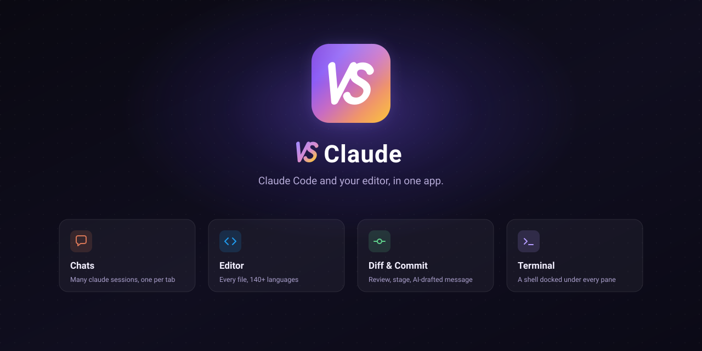

<div align="center">



# Vey Studio

**Claude Code and your editor, in one app.**

[](https://github.com/veystudioapp/vey-studio-releases/releases/latest)
[](https://github.com/veystudioapp/vey-studio-releases/releases)
[](LICENSE)

</div>

---

Claude Code in a terminal, an editor beside it to read what it changed — Vey Studio puts both in one window. Chats, files, diffs, a terminal and the commit are all tabs over the folders you already work in.

https://github.com/user-attachments/assets/88739502-55f2-4c27-ad84-6b630d66d701

## Download

Every build is on the [latest release][latest]:

| OS      | Architecture  | File                                   |
| ------- | ------------- | -------------------------------------- |
| macOS   | Apple Silicon | `Vey-Studio-<version>-arm64.dmg`       |
| macOS   | Intel         | `Vey-Studio-<version>-x64.dmg`         |
| Windows | x64           | `Vey-Studio-<version>-x64.exe`         |
| Linux   | x64           | `Vey-Studio-<version>-x86_64.AppImage` |

Every build is **unsigned**, so each OS objects in its own way. That is what the last line of each section below is about.

### macOS

macOS 12 (Monterey) or newer, Apple Silicon or Intel.

```bash
curl -fsSL https://raw.githubusercontent.com/veystudioapp/vey-studio-releases/main/install.sh | bash
```

[`install.sh`](install.sh) picks the build for your architecture from this repository's releases and copies it into `/Applications`. Run it again to update, or `| bash -s 1.0.16` to pin a version.

Use `curl` rather than a browser: macOS quarantines a download and Gatekeeper then calls the app _"damaged"_, which only ever means unsigned. A `.dmg` from [Releases][latest] works too, after `xattr -dr com.apple.quarantine "/Applications/Vey Studio.app"` — which skips the check rather than passing it.

### Windows

x64. The `.exe` is an NSIS installer. SmartScreen stops it: _More info_ → _Run anyway_.

### Linux

x64. The AppImage is the whole install.

```bash
chmod +x Vey-Studio-*.AppImage
./Vey-Studio-*.AppImage
```

It needs FUSE (`sudo apt install libfuse2` on Debian and Ubuntu), or `--appimage-extract-and-run` without it.

## Updating

The app checks this repository for a newer release and offers to install it — on macOS by running the same `install.sh`, on Windows by running the new installer silently once the app has quit. Re-running the install above does the same by hand.

## Requirements

Vey Studio is developed and used day to day on macOS; the Linux and Windows builds come out of the same workflow, but assume rough edges. The [`claude`](https://docs.anthropic.com/en/docs/claude-code) CLI is needed only for agent sessions and the AI features — not to start the app.

## Feedback

Bugs and requests go to [Issues](https://github.com/veystudioapp/vey-studio-releases/issues). Security reports should not: see [`SECURITY.md`](SECURITY.md). Everyone taking part is held to the [Code of Conduct](CODE_OF_CONDUCT.md).

To talk with other users, join the [Facebook community](https://www.facebook.com/groups/2095997741054237).

## License

[MIT](LICENSE).

[latest]: https://github.com/veystudioapp/vey-studio-releases/releases/latest
